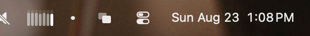
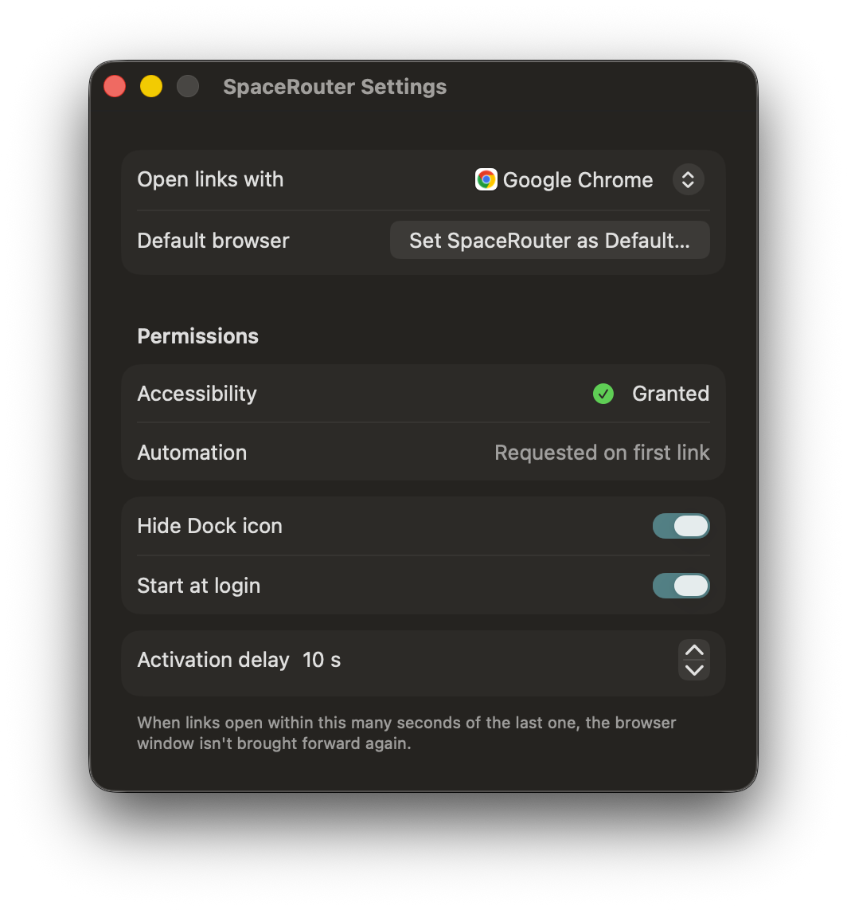

# PerSpaceLinkRouter

`PerSpaceLinkRouter` opens web links in the current Space, on the display under
your cursor. It requires macOS 13 or later and builds natively for Apple Silicon.

Do you use Spaces/Mission Control on your Mac?

Do you get frustrated when you open a web link, and you get switched to a
different Space or the link silently opens in a new browser tab in a different
Space?

Me too.

## How It Works

`PerSpaceLinkRouter` is set as the default web browser, so it receives any links that
are opened. When a link is opened, `PerSpaceLinkRouter` finds the display under the
mouse cursor and uses the Accessibility APIs to see if there is a browser window
in that display's current Space. If there is, the link opens in a new tab of the
frontmost such window. If there isn't, it opens a new browser window centered on
that display. Browser interaction uses the AppleScript scripting bridge.

## Installation

Download `PerSpaceLinkRouter-<version>.zip` from the
[latest release](https://github.com/lubelski/PerSpaceLinkRouter/releases/latest),
or build `PerSpaceLinkRouter.xcodeproj` with Xcode. Local builds are ad-hoc signed
with a stable designated requirement, so the Accessibility and Automation
grants survive rebuilds. See CLAUDE.md for the trade-off.

* Move `PerSpaceLinkRouter.app` into your `Applications` folder
* Launch `PerSpaceLinkRouter`
* Grant Accessibility access in `System Settings` > `Privacy & Security` >
  `Accessibility`
* Launch `PerSpaceLinkRouter` again
* Select the browser you want links opened with
* Click the `Set PerSpaceLinkRouter as Default Browser` button
* Open a link to verify it opens in your desired browser. The first open
  triggers an Automation permission prompt ("PerSpaceLinkRouter wants access to
  control ..."); allow it so `PerSpaceLinkRouter` can drive the browser

## Features

* Open links in the current Space
* Prevent window activation when opening several links in a row
* Menu bar icon with access to settings
* Optional hidden Dock icon
* Optional start at login
* Release builds update themselves

## Usage

You should now be able to open links as you do normally, and they should always
open in the current Space.

`PerSpaceLinkRouter` stays running as a menu bar agent. To change which browser it
forwards links to, click the menu bar icon and choose a browser from `Open Links
With`. A checkmark identifies the saved selection. You can also choose a browser
in `Settings…`, where you can toggle the Dock icon and start at login.

If you lose track of the window and the menu bar icon, launch `PerSpaceLinkRouter`
again. Reopening a running instance always shows the settings window.

If you decide `PerSpaceLinkRouter` isn't for you, you can restore your preferred
default browser by selecting it in `System Settings` > `Desktop & Dock` >
`Default web browser`.

## App Links

`PerSpaceLinkRouter` can open some links in their native app instead of the
browser. Each app has a toggle in the `App Links` section of `Settings…`. All of
them are off by default, and only apps you have installed are listed.

* Figma: design, FigJam board, slides, prototype, and Make links
* Zoom: meeting links (`zoom.us/j/…`, including company subdomains)
* Slack: channel and DM links from the web client (`app.slack.com/client/…`)
* Discord: channel and DM links (`discord.com/channels/…`)
* Spotify: track, album, artist, playlist, show, and episode links

Hold Option (⌥) while opening a link to send it to the browser anyway. A link
that an app hands back to the browser itself, such as Figma's `Open in
Browser`, also goes to the browser instead of looping back into the app.

Known limitation: the per-Space routing only applies to browsers. An app link
opens wherever the app puts it, which may be a window in another Space. macOS
has no public API for moving another app's windows between Spaces.

## Updates

A build from the releases page updates itself with
[Sparkle](https://sparkle-project.org). It checks the feed on GitHub about once
a day, downloads a newer build, verifies its signature, and relaunches into it.
`Settings…` has a checkbox that turns this off, and the menu has `Check for
Updates…`.

A build you make yourself with Xcode has no feed and never updates itself.

## Supported Browsers

Current versions of the following should work.

* Safari
* Safari Technology Preview
* Chrome

## Privacy

`PerSpaceLinkRouter` does not and will never log anything about the URLs that it
opens.

You can walk through the entire execution path from where the link open event
is handled (`handleGetURLEvent` in
[AppDelegate.swift](/PerSpaceLinkRouter/AppDelegate.swift)), to the general browser
handling (`openURL` in
[BrowserManager.swift](/PerSpaceLinkRouter/BrowserManager.swift)), to the app
link rules ([AppLinkRouter.swift](/PerSpaceLinkRouter/AppLinkRouter.swift) and
[AppLinkRule.swift](/PerSpaceLinkRouter/AppLinkRule.swift)), to the
browser-specific handling for [Chrome](/PerSpaceLinkRouter/Browsers/Chrome.m),
[Safari](/PerSpaceLinkRouter/Browsers/Safari.m) and [Safari Technology
Preview](/PerSpaceLinkRouter/Browsers/SafariTechnologyPreview.m).

Sparkle is the only third party framework. A release build uses it to fetch
the update feed and new builds from GitHub, and it sends nothing about you or
your links.

## License

`PerSpaceLinkRouter` is released under the [GPL](/LICENSE) license. It is derived
from OpenHere by Marc Schwieterman.

## Attribution

AppleScript, Mission Control, and Spaces are trademarks of Apple Inc.,
registered in the U.S. and other countries.
